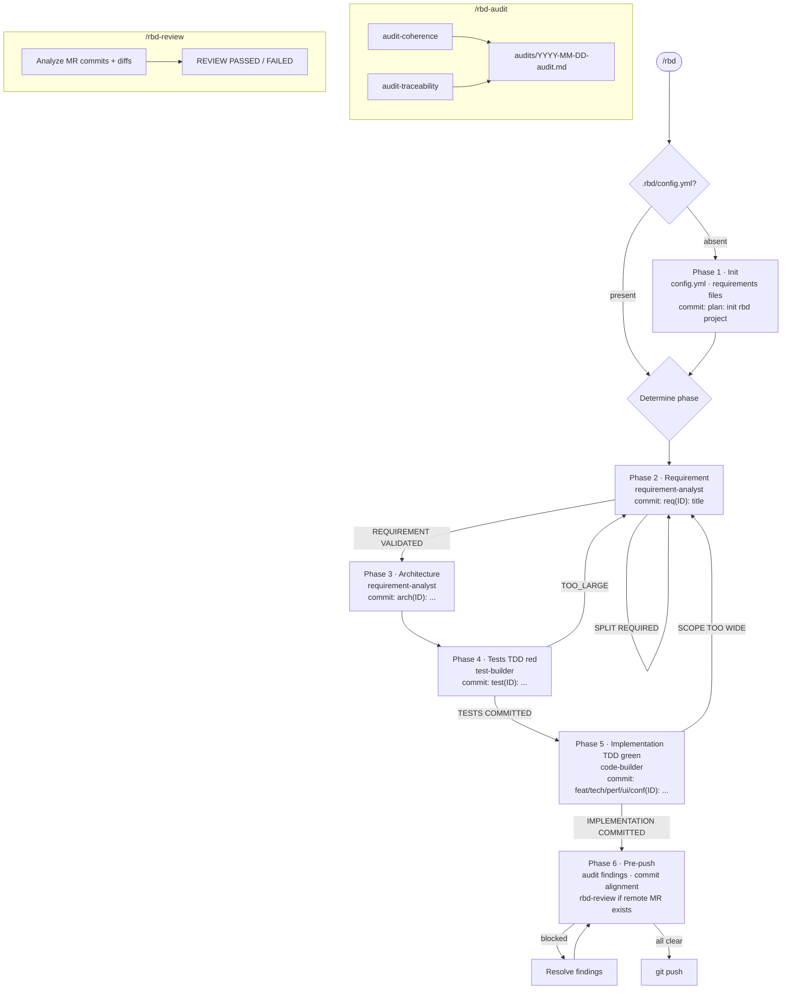

# RBD — Requirement-Based Development

## The Problem

Six months after a feature ships, nobody remembers why a function exists. The ticket is closed. The PR says "fix edge case." You read the code, you understand *what* it does — you have no idea *whether you can change it*.

That's the code archaeology problem. Not a quality failure — a traceability failure. The decision was made somewhere, just not anywhere you can find it now.

## What is RBD?

**Requirement-Based Development** is a discipline where every code change originates from a written, validated requirement. Not a ticket. Not a task. A requirement: a precise, testable statement of what the system must do and why.

This is not Agile. Agile manages delivery cadence — it says nothing about traceability between decisions and code. This is not TDD. TDD ensures your code is correct — it doesn't record *why* the test exists. This is not an issue tracker. A closed ticket is an archive; a validated requirement is a living contract the codebase is held against.

RBD sits on top of all of these. You can run sprints, write tests, use GitHub issues — and still have a codebase where every behavior is traceable to a written reason.

## The Four Invariants

1. **No code without a requirement.** Every committed behavior is traceable to a validated, written requirement.
2. **No requirement without tests.** Before any implementation, integration tests tagged with the requirement ID are committed (TDD red). The test exists *because* the requirement exists.
3. **No test without a requirement.** Orphan tags — referencing a non-existent ID — are a hard audit failure.
4. **Continuous auditability.** At any point, a full audit can verify that requirements, tests, and code form a coherent, gap-free chain.

If any link in that chain is missing, you know exactly where the gap is — and exactly what to do about it.

## This Plugin

This plugin implements the RBD workflow for Claude Code. It enforces the invariants through a structured cycle: requirement elicitation and challenge, architecture update, TDD red phase, implementation, and pre-push verification. Each phase is guided — you are never left wondering what to do next.

The workflow is intentionally structured but lightweight:

- Requirements are challenged *before* tests are written, so splitting a bloated requirement never forces rework.
- The `plan:` commit type covers workflow-level changes without dragging them into the TDD cycle.
- Audit findings block new audits until resolved — technical debt stays visible and actionable.

## Workflow Overview



## Skills

| Skill | Invoke | Purpose |
|-------|--------|---------|
| `rbd` | `/rbd` | Guided workflow: init, requirement discussion, TDD cycle, pre-push checks, `/rbd release <tag>` bench gate |
| `rbd-audit` | `/rbd-audit` | Read-only audit with two parallel agents: changes since the last report, or `--full` |
| `rbd-review` | `/rbd-review` | MR/PR review from a requirements perspective |
| `rbd-links` | `/rbd-links` | Link every cited requirement ID to its heading; `--check` lists broken or missing links |

## Quick Start

1. Install this plugin in Claude Code.
2. In your project, invoke `/rbd` — it detects a missing config and guides you through initialization.
3. Whenever you want to add a feature or constraint: `/rbd` to start the workflow.
4. Before pushing: the pre-push hook runs automatically, or run Phase 6 (pre-push check) manually via `/rbd`.
5. For an audit: `/rbd-audit` checks what changed since the last report; `/rbd-audit --full` checks the whole repository.
6. Before merging a branch: `/rbd-review`.
7. Before tagging a release: `/rbd release <tag>` checks every bench sheet has a passing row for that release.

## Project Structure Created on Init

```text
.rbd/
  config.yml          # ID format, test tagging convention, linter command,
                      # optional extra_commit_prefixes: [hw] (accepted by the pre-push hook)
                      # optional draft_ok_prefixes: [test] (may cite draft requirements)
                      # optional rules: { non_technical_without_code: true } (audit C2)
                      # optional test_tagging.bench_sheets: "tests/bench/{id}.md" (the default)
  plan-files.yml      # workflow files monitored for plan: commit discipline

requirements/
  functional.md       # FUNC-* requirements
  technical.md        # TECH-* requirements
  performance.md      # PERF-* requirements
  ui.md               # UI-* requirements
  configuration.md    # CONF-* requirements

audits/
  exclusions.yml                     # justified audit exclusions
  YYYY-MM-DD-audit.md                # timestamped full audit reports
  YYYY-MM-DD-audit-2.md              # second audit of the same day (then -3, ...)
  YYYY-MM-DD-review-<branch>.md      # MR review reports

tests/bench/                         # created when a manual hardware check is needed
  <ID>.md                            # bench sheet, tagged <!-- @req <ID> -->, one Results row per release
  bring-up.md                        # release checklist: the order the sheets are run in
```

## Pre-push Hook

- The hook reads the commit log **before** the Bash command runs. A command that rewrites a message
  (`git commit --amend`, `git filter-branch --msg-filter …`) and pushes in the same line is checked on the old
  message: run the rewrite and the push as two separate commands.
- A commit may cite several IDs (`test(FUNC-A-001,TECH-B-002): …`) or a range (`req(FUNC-X-001..015): …`); every
  ID is checked.
- Commits citing a `draft` requirement are blocked, except for the prefixes in `draft_ok_prefixes`.
- Bench results never block a push: pending bench sheets are `info` in `/rbd-audit`, and only `/rbd release <tag>`
  waits for them.
- Tests still tagged with a `draft` ID are a T2 warning of `/rbd-audit`; a `validated` requirement depending on a
  `draft` one is a C3 finding. Re-validate the draft requirement, or remove the tests, their tag or the dependency.

## Plan File Commit Gate

A commit that changes a file listed in `.rbd/plan-files.yml` is refused unless its subject starts with `plan:` or
with a prefix that `accepted_prefixes:` allows for that file: the commit-time version of audit check T4. Merge
commits are not checked.

- Inside Claude Code it runs as a PreToolUse hook on `git commit -m …`, nothing to install. It sees the index, `-a`,
  and the paths of a `git add` earlier in the same command.
- To also cover commits made by hand, install the git `commit-msg` hook as a shim calling the plugin script (the
  shim picks the newest installed version, so it follows plugin updates):

  ```bash
  cat > .git/hooks/commit-msg <<'EOF'
  #!/bin/sh
  exec bash "$(ls -d ~/.claude/plugins/cache/*/rbd/*/hooks/rbd-plan-file-check.sh | sort -V | tail -1)" "$1"
  EOF
  chmod +x .git/hooks/commit-msg
  ```

## Commit Convention

```text
req(ID):   requirement validated and committed
test(ID):  integration tests committed (TDD red)
feat(ID):  functional requirement implemented
tech(ID):  technical requirement implemented
perf(ID):  performance requirement implemented
ui(ID):    UI requirement implemented
conf(ID):  configuration value set
arch(ID):  architecture document updated (ID = triggering requirement)
plan:      workflow file changed (no ID — no TDD cycle)

# Multi-requirement (avoid — suggest splitting)
feat: description
Requirements: ID-001, ID-002
```

## Requirement Categories

| Category | ID prefix | Commit prefix | Tests |
|----------|-----------|---------------|-------|
| Functional | FUNC-... | feat(ID): | required |
| Technical | TECH-... | tech(ID): | required |
| Performance | PERF-... | perf(ID): | required |
| UI | UI-... | ui(ID): | required |
| Configuration | CONF-... | conf(ID): | required |
| Plan | *(no file)* | plan: | none |

## Workflow Summary

```text
Phase 1: Init         → .rbd/config.yml created, commit: plan: init rbd project
Phase 2: Requirement  → requirements/*.md updated, commit: req(ID): title
Phase 3: Architecture → docs/architecture.md updated, TECH reqs for DI,
                        commits: req(TECH-*): ... + arch(ID): update architecture
Phase 4: Tests        → tests written and tagged, linted, commit: test(ID): ...
Phase 5: Implement    → agent implements, full suite green, linted, commit: feat(ID): ...
Phase 6: Pre-push     → audit check + branch alignment + rbd-review if MR exists
```

## Design

The original design spec was removed; the plugin is now described by its own requirements and architecture:

- [requirements/](requirements/): functional, technical, performance, UI, configuration and platform requirements
- [docs/architecture.md](docs/architecture.md): components, hooks and agents
- [CHANGELOG.md](CHANGELOG.md): changes per version
